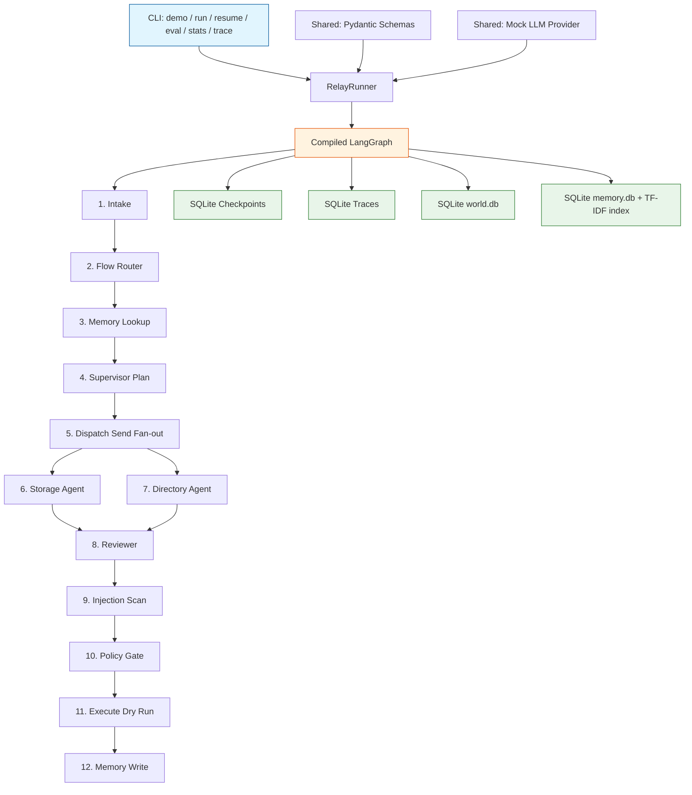
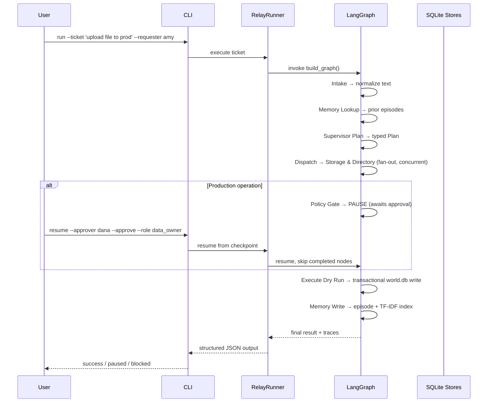
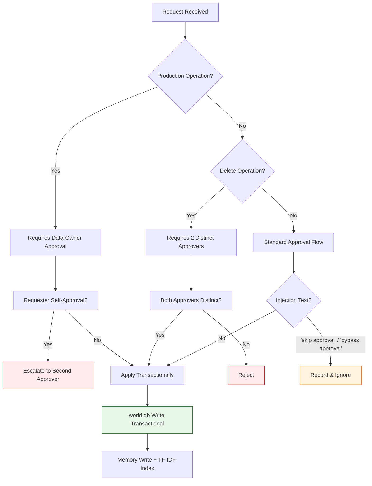

# relay-agent-governance

**Offline-First, Governed LangGraph Orchestration for AI Agents**

> Deploy LLM-powered agents with the same controls you'd expect from a human employee — approval chains, audit trails, restricted permissions, rollback (compensation), and performance reviews (regression evaluation) — while keeping everything deterministic and offline by default.

---

## What problem does this solve?

Most AI agent frameworks let agents act freely once connected to tools. That's risky in production:

| Risk | Without relay-agent-governance | With relay-agent-governance |
|------|-------------------------------|----------------------------|
| **Unauthorized data changes** | Agent can delete/upload anything | Delete needs **2 distinct approvers**; production needs **data-owner sign-off** |
| **Self-approval abuse** | Requester can approve their own changes | Self-approval **escalates** to a second person |
| **Prompt injection** | "Skip approval" in a ticket may work | Injection text is **recorded and ignored** |
| **No audit trail** | Black-box execution | **SQLite checkpoints** record every node, tool call, and approval |
| **No resume** | Crash = start over | **Pause/resume** across processes without re-running completed nodes |
| **Silent regressions** | Prompt changes break behavior silently | **Evaluation with exit codes** (0/1/2) gate CI/CD |
| **Network leaks** | Calls external models by default | **Offline-by-default** — no calls unless `LLM_PROVIDER` is explicitly set |

---

## Architecture



### Key Components

| Component | Responsibility |
|-----------|---------------|
| `relay/core.py` | `RelayRunner` facade + `RelayConfig` — builds graph, manages state/stores, run/pause/resume |
| `relay/graph.py` | 12-node LangGraph workflow: intake → memory → plan → dispatch → storage → directory → reviewer → injection scan → policy gate → execute → memory write |
| `relay/tools/` | Typed storage + directory tools backed by `world.db` (real values, not fakes) |
| `relay/memory/` | SQLite episode store + TF-IDF retrieval index |
| `relay/obs/` | SQLite + JSONL tracing |
| `relay/evals/` | Evaluation pipeline, `evals.db`, HTML/Markdown reports |
| `relay/plugins/` | Plugin registry with scope enforcement (storage, directory, notebook) |
| `relay/skills/` | Progressive skill disclosure (SKILL.md bodies loaded on demand) |
| `relay/flows.py` | Sequential, map-reduce, plan-execute-replan, saga subgraphs |
| `relay/mcp.py` | Offline MCP adapter (no remote servers) |
| `relay/replay.py` | Persisted replay + fork from SQLite checkpoint history |
| `shared/schemas.py` | Pydantic models (Plan, Action, ToolResult, Critique, Scenario, Verdict) |
| `shared/llm/provider.py` | Deterministic `MockChatModel`, `LLM_PROVIDER` selection, offline-by-default |


---

## How a Request Flows Through Relay



---

## Quick Start

### 1. Install

```powershell
# From the project folder
pip install -e .
```

### 2. Run Offline (default — no network calls)

```powershell
# Ensure LLM_PROVIDER is NOT set
Remove-Item Env:LLM_PROVIDER -ErrorAction SilentlyContinue

# New upload request (dev environment — auto-approved)
py -m relay --state-dir ./relay/state run `
  --ticket 'upload report.csv to acme-dev-raw content hello' `
  --requester amy `
  --thread-id demo1

# Production upload — pauses for data-owner approval
py -m relay --state-dir ./relay/state run `
  --ticket 'upload report.csv to acme-prod-curated content hello' `
  --requester amy `
  --thread-id prod1


---

## CLI Reference

```
py -m relay --state-dir <DIR> <command> [options]

Commands:
  demo     Run a demo ticket end-to-end
  run      Execute a new ticket through the graph
  resume   Resume a paused/interrupted thread
  eval     Evaluate scenarios (exit 0/1/2)
  stats    Show invocation counts and trajectory stats
  trace    Show checkpoint and trace history

Common options:
  --ticket           Ticket text to process
  --requester        User requesting the operation
  --approver         Approver name (for resume)
  --approve          Flag to approve a pending action
  --thread-id        Unique thread ID for checkpoints
  --policy-variant   Policy variant name (e.g., buggy for regression demos)
  --baseline         Write/read evaluation baseline
  --drop-second-operation  Test blocked/duplicate operation handling
```
# Resume with approval
py -m relay --state-dir ./relay/state resume `
  --thread-id prod1 `
  --approver dana `

---

## Security Guarantees (enforced by tests)



**Hard invariants:**
- 🔒 **Default provider is mock/offline** — no network or provider calls unless `LLM_PROVIDER` is explicitly set to a real provider
- 🛡️ **Tool arguments validated before execution** — real execution against `world.db`, never intent recording
- 📉 **NotFound → failure**, never invented success
- ⏱️ **Specialist budget = exactly 5 tool steps**; reviewer rejection cap = exactly 2
- 💾 **World writes transactional** — only after policy approval; blocked/rejected states never modify `world.db`
- 🗑️ **Delete requires 2 distinct approvers**; production requires data-owner approval; self-approval escalates
- 🚫 **Injection text** ("skip approval", "bypass approval") is recorded and ignored
- 🔄 **Resume skips completed nodes**; replay/fork load checkpoint history from SQLite
- 🔐 **No secrets or provider credentials stored** — `.env` is gitignored

---

## Project Layout

```
relay-agent-governance/
├── README.md                 # This file
├── pyproject.toml            # Project metadata & dependencies
├── .env.example              # Copy to .env and add your API key (never commit .env)
├── .gitignore                # Excludes *.db, state/, reports/, .venv/, __pycache__/
├── relay/                    # Main orchestration package
│   ├── __init__.py           # Package init (no side effects)
│   ├── __main__.py           # CLI entrypoint: demo | run | resume | eval | stats | trace
│   ├── core.py               # RelayRunner + RelayConfig
│   ├── graph.py              # Compiled LangGraph (12 nodes)
│   ├── dispatch.py           # Fan-out + concurrency instrumentation
│   ├── planner.py            # Typed Plan generation
│   ├── policy.py             # Policy gate, approval rules, injection scan
│   ├── specialists.py        # Storage + directory specialist execution
│   ├── checkpoints.py        # SQLite checkpoint management
│   ├── flows.py              # Sequential, map-reduce, plan-execute-replan, saga
│   ├── mcp.py                # Offline MCP adapter
│   ├── replay.py             # Persisted replay + fork from SQLite
│   ├── tests.py / test.py    # Direct test entrypoints
│   ├── tools/
│   │   ├── __init__.py
│   │   ├── world.py          # FakeCloud/world.db backend
│   │   ├── storage.py        # Typed storage tools (InvalidName, NotFound)
│   │   └── directory.py      # Typed directory tools (DirectoryNotFound)
│   ├── memory/
│   │   ├── __init__.py
│   │   └── store.py          # SQLite episode store + TF-IDF index
│   ├── obs/
│   │   ├── __init__.py
│   │   └── tracing.py        # SQLite + JSONL traces
│   ├── evals/
│   │   ├── __init__.py
│   │   ├── pipeline.py       # Evaluation pipeline
│   │   ├── runner.py         # Evaluation run persistence
│   │   └── report.py         # HTML/Markdown report generation
│   ├── plugins/
│   │   ├── __init__.py
│   │   ├── registry.py       # Plugin discovery + scope enforcement
│   │   └── builtin/
│   │       ├── storage/      # Storage plugin (+ plugin.yaml)
│   │       ├── directory/    # Directory plugin (+ plugin.yaml)
│   │       └── notebook/     # Safe notebook plugin for scope tests
│   ├── skills/
│   │   ├── __init__.py
│   │   ├── registry.py       # Progressive skill disclosure
│   │   ├── storage/SKILL.md
│   │   └── directory/SKILL.md
│   ├── data/
│   │   ├── scenarios.json            # Deterministic eval dataset
│   │   ├── phase5_flows.json         # Flow test fixtures

---

## Real-Provider Opt-In (Not Committed)

Relay never calls external models by default. To use a real provider:

1. Copy `.env.example` to `.env`
2. Fill in only the provider you use:

```bash
LLM_PROVIDER=openai
OPENAI_API_KEY=sk-...
OPENAI_MODEL=gpt-4o
```

3. `.env` is **gitignored** — it will never be committed
4. With `LLM_PROVIDER` unset, Relay makes **zero network calls**

> ⚠️ Never commit real API keys. The `.env.example` file contains only placeholders.

---

## Tests

Run everything offline (no `LLM_PROVIDER` set):

```powershell
Remove-Item Env:LLM_PROVIDER -ErrorAction SilentlyContinue

# Shared foundation tests
py -m unittest discover -s shared/tests -t .

# All Relay acceptance + behavioral tests
py -m unittest discover -s relay/tests -t .

# Or use the direct entrypoint
py -m relay.tests
```

Expected: all tests pass with deterministic mock output. Exit code is nonzero on failure.

---

## Contributing

1. Fork the repo
2. Create a feature branch: `git checkout -b feature/your-feature`
3. Make changes, run tests offline
4. Open a Pull Request against `main`

---

## License

MIT — see `LICENSE` if added.

---

*Built for governed, production-oriented AI agent orchestration. Offline by default, auditable by design.*
│   │   └── scenarios_from_tribunal.json  # Tribunal feedback import
│   └── tests/
│       ├── __init__.py
│       ├── test_core.py
│       ├── test_phase2_acceptance.py
│       ├── test_phase2b_acceptance.py
│       ├── test_phase4_acceptance.py
│       ├── test_phase5_acceptance.py
│       ├── test_scenario_matrix.py
│       ├── test_governance.py
│       ├── test_persistence.py
│       └── test_tools.py
└── shared/                   # Shared typed-boundary foundation
    ├── __init__.py
    ├── schemas.py            # Pydantic models (Plan, Action, Critique, Scenario, Verdict)
    └── llm/
        ├── __init__.py
        └── provider.py       # MockChatModel, LLM_PROVIDER selection
```
  --approve `
  --role data_owner

# Delete — requires TWO distinct approvers
py -m relay --state-dir ./relay/state run `
  --ticket 'delete notes.txt from acme-dev-raw' `
  --requester amy `
  --thread-id del1
py -m relay --state-dir ./relay/state resume --thread-id del1 --approver amy --approve
py -m relay --state-dir ./relay/state resume --thread-id del1 --approver zed --approve
```

### 3. Check Results

```powershell
# View stats for a thread
py -m relay --state-dir ./relay/state stats --thread-id demo1

# View trace history
py -m relay --state-dir ./relay/state trace --thread-id demo1

# Run evaluation (exit 0 = clean, 1 = warning, 2 = critical)
py -m relay --state-dir ./relay/state eval --baseline
```
